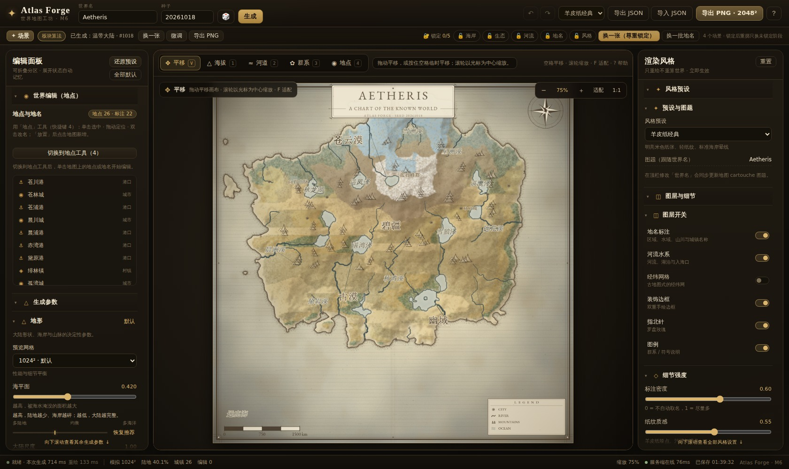
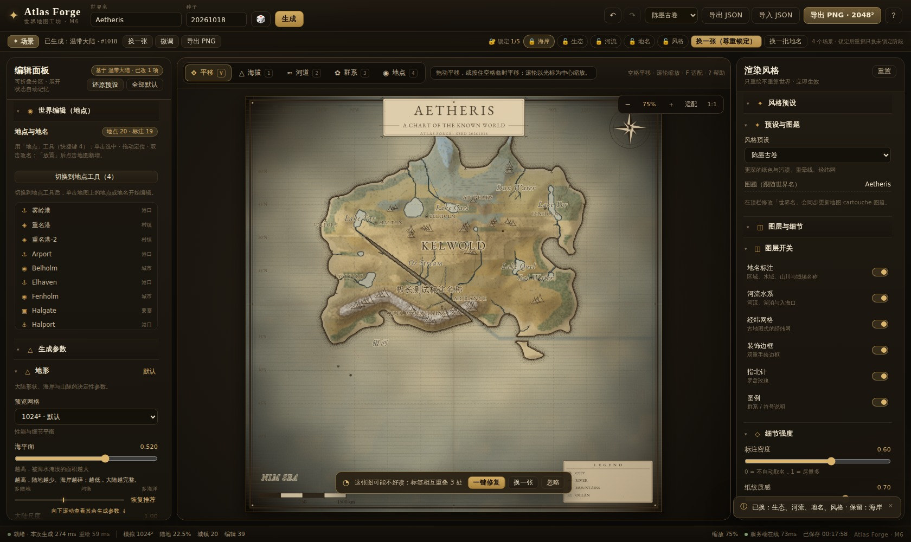
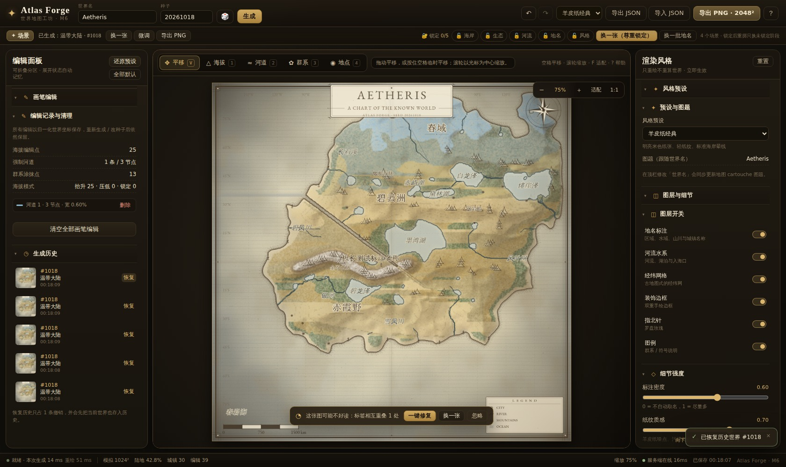
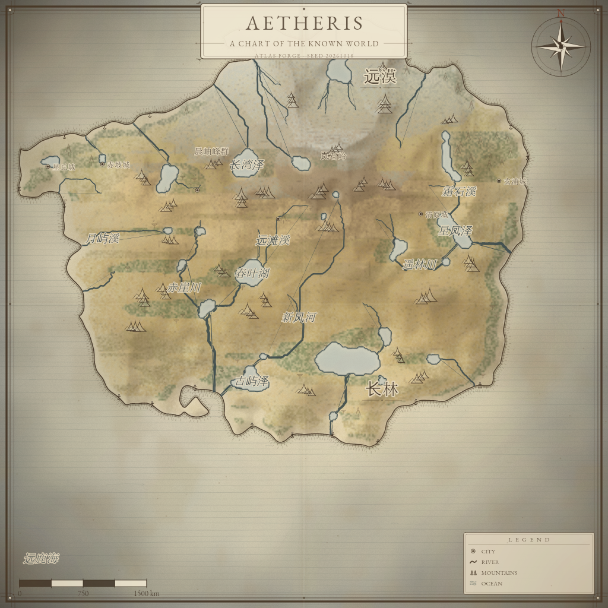
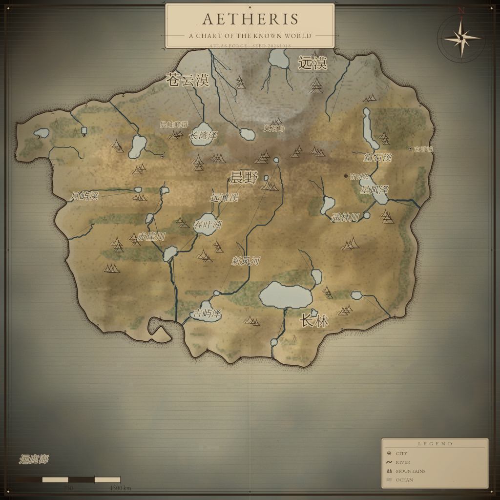
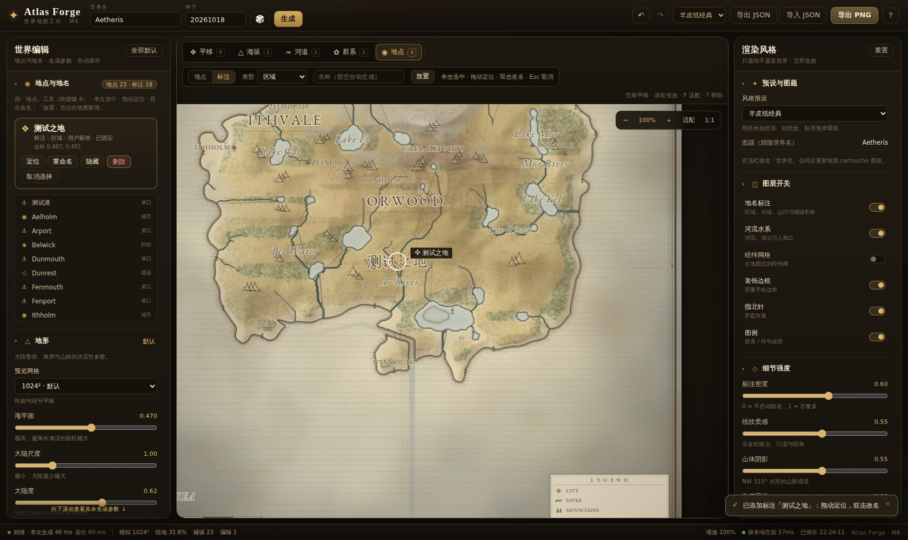
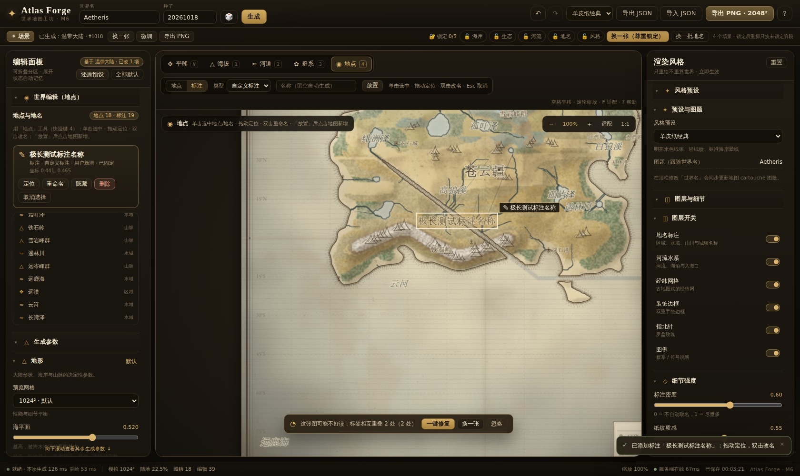
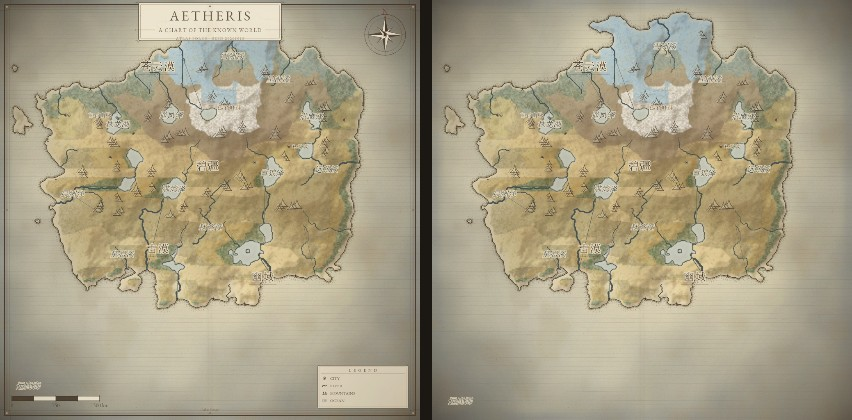

# Atlas Forge · 程序化世界地图生成器

[](https://github.com/Umamed26/atlas-forge/actions/workflows/ci.yml) · [github.com/Umamed26/atlas-forge](https://github.com/Umamed26/atlas-forge)

> 面向小说 / 世界观创作者的 Web 工具：用「种子 + 参数 + 少量画笔」，几分钟内生成一张**自洽、可编辑、可导出**的羊皮纸世界地图。



---

## 亮点

- **真模拟，不是随机噪声拼贴**：大陆 fBm + domain warping + 径向衰减 → ridged 山脉 + 侵蚀 → priority-flood 填洼 → D8 汇流 → 河网/湖泊 → 纬度温度 + 风带 + 湿润度平流 + 雨影 → 群系 → 城镇/地名。河流保证向下游入海或入湖，沙漠出现在背风面。
- **参数生成 + 画笔精修**：海拔抬升/压低/锁定、强制河道、群系涂抹。所有编辑以**归一化世界坐标的 override** 保存，重新生成、改种子再改回种子都不丢。
- **地点与地名编辑**：单击选中、双击改名、拖动定位、隐藏/恢复、新增地点（城/镇/港/堡/遗迹）与标注（区域/水域/山脉/自定义）；全部写入世界 JSON，支持撤销/重做与自动保存。
- **羊皮纸渲染**：海拔色带 + 山体阴影 + biome 色带 + 手绘海岸线/晕线 + 河流渐细 + 纸纹做旧 + 双重边框 + 标题饰框 + 指北针 + 比例尺 + 图例 + 分级地名 + portolan 航向线。浏览器预览与 Node 大图导出**共用同一份渲染代码**。
- **浏览器交互 + 后端大图**：1024² 交互预览（Worker 生成、120ms debounce、latest-wins），2048² 本地离屏导出，4096²/8192² 由 Node 服务渲染。
- **世界 JSON 是唯一真源**：PNG 只是产物；导入/导出、自动保存、撤销/重做都围绕这份文档。
- **可验证的地理说服力（v0.5）**：因果气候（纬度 + 海拔递减 + 距海大陆度 + 盛行风 + 地形雨影）、Whittaker 群系表与随纬度下降的雪线、Strahler 级序河网（河宽 ∝ √流量，入海有三角洲，无悬挂河）、湖泊尺寸上限与内陆盆地抬升。所有结论都有 `pnpm qa:algo` 的多 seed 分布门禁兜底。
- **所有装饰可配置（v0.6）**：标题饰框、指北针、比例尺、图例、经纬网、边框、页脚署名各自独立开关、四角换位、改文案；关闭后**不占位置**，导出 SVG 里也不会留下空节点。切换只重绘、不重新生成世界，且可撤销。
- **矢量印刷输出（v0.5）**：`导出 → SVG（印刷）`，分层矢量（海岸线 / 河流按级序变宽 / 湖泊 / 群系 / 文字 / 装饰），支持 A3@300dpi 物理尺寸；PNG 与 SVG 共用同一套几何提取，不会出现"两张图不一样"。
- **为长期编辑打磨**：地点命中用**渲染器同源文字包围盒**（点标签尾部也能选中、重叠取最上层）；撤销按「一次用户动作」一条；导入先校验再替换、坏 JSON 不半加载；自动存档主/备双槽，损坏时可恢复；导出显示尺寸/文件名/进度并可取消。

### 第一次打开就到手一张好图


首次打开会先让你选一个世界（群岛贸易 / 干旱帝国 / 极地边疆 / 温带大陆）。每张卡打包了**地形参数 + 风格 + 命名语言**，点一下 10 秒内拿到第一张能看的图；之后随时可在顶栏「场景」里更换。



喜欢当前这一张？用 **5 个锁** 把喜欢的东西锁住再「换一张」：海岸 / 生态 / 河流 / 地名 / 风格。锁住海岸后连续换 10 次，轮廓逐像素不变，只换其余部分；「换一批地名」更是只重算取名，地形与河流一动不动。



**最近 10 次生成**都留了缩略图，点一下就能回到上一张，不怕手滑。

| 经典羊皮纸 | Aged Ink |
| --- | --- |
|  |  |





## 快速开始

环境：Node.js ≥ 20（开发用 Node 24）、pnpm ≥ 9。首次安装依赖后一条命令启动：

```bash
pnpm install
pnpm dev            # web: http://localhost:5173  api: http://127.0.0.1:8787
```

`pnpm dev` 会同时启动 Vite 前端与导出服务；端口可用 `WEB_URL` / `PORT` 覆盖。只做本地交互预览也可 `pnpm dev:web`（此时 4096/8192 导出会提示服务离线并降级到本地 2048）。

## 使用指南

- **开始**：首屏选场景，或点「随机一张」；顶栏「场景」可随时更换。
- **生成**：顶栏「换一张」按锁定项重掷；工具栏旁锁定条可锁 海岸 / 生态 / 河流 / 地名 / 风格。生成后顶栏显示「已生成：<场景> · #<seed>」，旁边直接给 换一张 / 微调 / 导出 PNG。
- **微调**：左侧参数按「地形 / 水文 / 气候 / 人文」分组，每个滑杆都有**结果语言**说明与 低/中/高 语义刻度、场景推荐刻度；拖动时先出 512² 草稿（画布角标「草稿」），松手再全量重算；「换一批地名」只重算命名。
- **结果检查**：生成完成后自动检查可读性（陆地比例、河流、标签重叠/越界、城镇密度、色彩对比），有问题时在画布下方给非阻断提示，可「一键修复 / 换一张 / 忽略」。
- **画布**：滚轮以光标为中心缩放，拖拽或按住空格平移，`适配` / `1:1` 复位；右上角缩放控件。
- **编辑**：工具栏切 海拔 / 河道 / 群系。海拔有抬升、压低、锁定三种模式（半径、强度可调）；河道点击落点、回车或双击提交，可调宽度；撤销 Ctrl+Z，重做 Ctrl+Shift+Z / Ctrl+Y。
- **地点/地名**：切到「地点」工具（快捷键 4）后，悬停高亮、单击选中；双击改名、拖动定位；左侧检查器可「定位 / 重命名 / 隐藏 / 删除」，隐藏条目在「隐藏与恢复」中可找回；工具条可切换「地点/标注」并在地图点击放置新条目。
- **导出**：`导出 JSON` 下载唯一真源；`导出 PNG` 按钮显示当前尺寸，弹窗预览文件名 `atlas-<world>-<seed>-<preset>-<size>.png` 与各阶段进度，可随时取消；4096/8192 走服务端（8192 显式 opt-in），服务离线时可降级本地 2048。
- **导入/自动保存**：导入先经 core 校验/规范化，坏 JSON 给可读错误且不替换当前世界；自动保存在主/备双槽，损坏存档会弹出恢复面板（恢复上一份 / 清空），不会静默覆盖。
- **面板**：左右栏为可折叠分组（世界编辑 / 生成参数 / 画笔编辑；风格预设 / 图层与细节 / 统计与图例），标题吸顶，展开状态记住；1280×800 与 1024×768 下不横向溢出（桌面优先，未承诺触控拖动/双击）。
- **帮助**：右上角 `?` 查看完整快捷键与编辑说明。

快捷键（单一来源 `apps/web/src/lib/shortcuts.ts`，帮助面板与实际行为同源）：`Ctrl/⌘+Z` 撤销 · `Ctrl/⌘+Shift+Z` 重做 · `Ctrl/⌘+Enter` 立即重算 · `1/2/3/4` 海拔/河道/群系/地点 · `V` 平移 · `Space`（按住）临时平移 · 滚轮缩放 · `+/-` 缩放 · `F` 适配 · `0` 1:1 · `Enter/双击` 完成河道 · `Backspace` 删河道末点 · 双击地点改名 · 拖动地点定位 · `Delete` 删除用户新增地点 · `Esc` 按 弹窗→重命名→放置→选中→河道 取消 · `?` 帮助。



左侧默认（标题/指北针/比例尺/图例/署名/边框），右侧一键「全部关闭」后的干净底图：不占位、无残留。

## 地图装饰与排版（v0.6）

`style.decorations` 是装饰的**唯一真源**（7 个稳定 id：`title` / `compass` / `scaleBar` / `legend` / `graticule` / `border` / `credits`），每项可配 `visible`、`anchor`（四角/上中/下中）与文案。浏览器预览、PNG 导出、SVG 导出、印刷管线读取同一棵装饰树与同一份布局：

- 隐藏元素在布局中为**零尺寸**，不占位、不进标签避让区；SVG 中不输出对应 `data-decor` 节点（全关即干净底图）。
- 标题按**安全区中心**对齐（不受边框/出血影响），左右留白差 ≤1px；元素两两不重叠（宽标题会自动把角落元素下推）。
- SVG 文本使用 `text-anchor` + 显式基线（不用 `dominant-baseline`，避免不同渲染器差异）。
- 旧文档（只有 `showCompass` 等布尔）在导入时自动迁移到元素树。

## 算法（v0.5 / v0.6）

| 层 | 做法 | 验收 |
| --- | --- | --- |
| 地形 | 默认 fBm 大陆骨架 + **域扭曲多倍频海岸细节（侵蚀之后施加，避免被平滑）**；可选**板块构造模型**（Voronoi 板块、收敛边界造山带、离散裂谷） | 海岸盒计数维数 **p50 1.19 / min 1.14**（v0.5 为 1.14/1.09）；陆地 36–47% |
| 侵蚀 | 热力滑落 + 液滴侵蚀 + **stream-power**（A^0.5·S 下切，仅陆地）；侵蚀后填平浅坑 | 陡坡占比 >3%，山脊不被抹平 |
| 水文 | priority-flood 填洼 → D8 → 汇流；**Strahler 级序**、河宽 ∝ √flow、三角洲分叉、内流湖 | 悬挂河 0.00%，最大级序 ≥4，单湖 ≤2% 地图 |
| 气候 | 纬度温度带 + 海拔递减 + **距海 BFS 大陆度** + 纬向风带 + 迎风升坡降水 / 背风雨影 | 背风面显著更干；赤道暖、两极冷 |
| 群系 | **Whittaker 温度×降水查表** + 海滩/湿地/山地/雪线特例 | 每 seed ≥12 群系；雪线随纬度下降 |
| 人文 | 宜居度选址 + 文化命名（中日/拉丁），地名避让与分级 | 城镇 8–80，标签 12–60 |

**兼容性**：`WorldParams.terrainModel`（`fbm` 默认 / `plates` 实验）与 `WorldDocument.algorithmVersion`。缺版本字段的旧世界按 **fbm + 旧管线**逐字节还原（`stage-seeds` 黄金哈希测试锁定），可在顶栏一键「试用板块地形」并撤销。

**可复现性**：同 seed + 同文档在浏览器 Worker 与 Node 服务端输出一致；阶段哈希（terrain/hydrology/climate/biome/human）固化在 `algo-golden` 测试里。

## 架构

```
atlas_forge/
├─ apps/web/        Vite + React 19 + Zustand；Canvas2D 画布；Web Worker 跑生成管线；地点编辑/导出/自动保存
├─ apps/server/     Fastify + @napi-rs/canvas；大图导出（校验/队列/内存预检/PNG）
├─ packages/core/   纯 TS 无 DOM：RNG/噪声/地形/水文/气候/群系/人文/override/阶段缓存
├─ packages/render/ 共享 Canvas2D 渲染器：像素光栅 + 矢量叠层，浏览器与 Node 同代码
├─ scripts/         Node 出图 QA + Playwright 浏览器 E2E
└─ examples/        示例世界 JSON、成图 PNG、应用截图
```

**数据流**：`WorldDocument`（JSON，唯一真源）→ Worker 分层生成 → `WorldLayers`（typed arrays）→ `renderWorld()`。大图导出 `POST /api/render` 到 Node 重新生成 + 渲染。

**分层管线与缓存边界**（每层按参数指纹缓存，改下游只重算下游）：

| 阶段 | 内容 |
| --- | --- |
| terrain | 大陆 fBm + domain warping + 径向衰减；ridged multifractal 山脉；侵蚀；海拔 override 注入 |
| hydrology | priority-flood 填洼 → D8 汇流 → 河流阈值 → 湖泊；强制河道刻槽 |
| climate | 纬度温度 + 海拔递减；风带 + 湿润度平流 + 迎风/背风雨影 |
| biome | 温度 × 湿度 × 海拔 × 海岸；群系 override 覆盖 |
| human | 宜居度选址 → 城镇/港口；中文/拉丁程序化命名；分级 autoLabels |

**编辑 override** 用归一化世界坐标（`x,y,radius` / 折线点）存于 `document.overrides`，在各阶段边界栅格化注入，与网格分辨率解耦。

## 验证

```bash
pnpm typecheck        # 5 个 workspace 包
pnpm test             # core 82 tests / render 30 行断言（含可读性）
pnpm qa:render        # Node 出 3×1024 + aged-ink + 4096 PNG + 1 张 SVG
pnpm qa:algo          # 算法分布门禁（24 seed @512²；--full = 120 seed @1024²）
pnpm qa:baseline      # 重建渲染视觉基线（固定合成地形，与算法解耦）
pnpm qa:browser       # Playwright E2E：生成/调参/画笔/地点编辑/命中/导入失败/存档恢复/导出，截图到 out/e2e/
node apps/web/scripts/qa-ui.mjs   # 200 项 UI 交互断言（需 dev server）
node scripts/qa-gen-ux.mjs        # 20 项生成体验断言：首屏/锁定重掷/历史/草稿/可读性
pnpm qa:visual        # 8 条视觉回归基准（场景预设 × 固定 seed）
```

实测（本机，2026-10）：

- core 1024² 冷启 0.35–0.85s（管线 best 441ms）；同文档二次生成（缓存命中）15–25ms；只改下游参数 ~200–280ms
- 渲染 1024 preview 热路径 ~75–165ms；4096 导出端到端 3.7–8s（22–25MB PNG）；命中度量 ~0.7ms@1024
- 浏览器 E2E：0 console/page error、0 failed request。覆盖生成/调参/笔画/河道/撤销；地点放置/改名/撤销/拖动/隐藏恢复/新增标注；标签尾部点击（同源 bbox）、重叠 topmost、hover 不重算、重命名输入框内 Delete 守卫；坏 JSON 导入被拒且文档不变；自动存档损坏→恢复面板→恢复成功；导出文件名/进度/本地 PNG；折叠状态跨刷新记忆；1280/1024 宽度无溢出
- 生成体验专项（`qa-gen-ux.mjs` 20/20）：首屏四卡+真缩略图、预设参数生效（continuentScale=4 群岛）、锁海岸连换 3 次 **height/ocean 层级哈希一致**且 river 哈希变化、历史恢复、换地名不动地形、连续拖动草稿节流、下一步动作、预设还原、stageSeeds 跨刷新持久
- 算法分布门禁：`qa:algo` 9/9（120 seed 全量：陆地 p10–p90 38–45%、海岸分形维数 **p50 1.19 / min 1.14**、悬挂河 0.00%、Strahler≥5、单湖≤0.60%、群系≥12、1024² p95 **429ms**）
- 装饰契约：`decorations.test.ts` 12 项（逐元素关闭无节点/无占位、四角锚点、标题安全区居中 ≤1px、互不重叠、文本覆盖与转义）；`scripts/qa-decor.mjs` 14 项 UI 端到端（开关/换位/改文案/全关/撤销/对齐数值断言）
- 视觉回归：`qa:visual` 4/4 一致；基线已改为**固定合成地形**，算法升级不再触发基线更新（此前 8 条真实管线基线一升级就失效）
- 矢量导出：`renderSvg` 7 项测试（独立文档/确定性/XML 转义/A3@300dpi/内容对账/体积 72KB/空世界）；服务端 `POST /api/export/svg` 实测 1024² 198KB / 774ms
- UI 交互断言：`qa-ui.mjs` 141/141 通过（含撤销一致性、快捷键单一来源、a11y、窄屏、toast 去重、预算 sanity）
- 水文不变量：30 seeds × 192² 河格下游不升高、无断头/倒流、必到海/湖

## 已知限制

- 命中已改为渲染器同源文字包围盒；渲染器不可用时自动回退 marker 距离（debug `hitBoxesSource` 可观测），极端密集重叠仍按 drawOrder 取最上层。
- 自动命名使用随机音节（落盘后确定），重名会自动加稳定后缀；不追求全局唯一语义。
- 锁定语义：锁住阶段不写显式子 seed，因此锁定重掷时「种子编号」后缀不变，「换一张」只体现在未锁阶段与生成历史里。
- 应用场景预设等价于「按该场景新建世界」（会重置用户地点/标注，可撤销恢复）；已有世界想保留编辑请用「换一张 + 锁」而不是换场景。
- 可读性检查在生成/预设切换后计算一次（约 5–6ms）；仅改风格后横幅可能滞后到下一次生成。
- 本地自动保存仅保留「当前 + 上一份备份」两个槽位；恢复会先清理损坏主档再写回。
- 取消服务端导出会产生一次浏览器 `net::ERR_ABORTED`（预期行为）。
- 桌面优先：窄屏（≥1024）保证不溢出、按钮可点，但未承诺触控拖动/双击改名。
- **板块地形为实验性可选模型**：山系/裂谷按板块边界生成，但海岸与山带细节仍不及默认 fBm 地形，暂不作为默认；一键切换后可撤销。
- SVG 目前为「分层矢量地图」：文字仍是 `<text>`（依赖查看端字体），尚未做字体子集化与裁切路径；印刷前建议在 Inkscape/Illustrator 转曲。
- 8192² 为显式 opt-in + 内存预检，未在低内存机器上压测。
- 浏览器仅实测 Chromium；本地 PNG 导出依赖 OffscreenCanvas（不支持时回退主线程）。
- 预览画布为 1024 离屏渲染后缩放，极端放大略软；导出大图清晰。
- 首版明确不做：世界→大陆→区域下钻、球面投影、账号/云同步/分享链接、TRPG hex 网格与 VTT 导出。

## 字体与许可

界面与成图使用 [EB Garamond](https://github.com/octaviopardo/EBGaramond12)（SIL Open Font License，文件位于 `packages/render/assets/fonts/` 与 `apps/web/public/fonts/`）；Node 端缺字体时回退 Liberation Serif / FreeSerif，浏览器回退系统衬线字体，不会崩溃。

设计与实现细节见 [TODO.md](./TODO.md)（决策、数据契约、里程碑与验收）。
